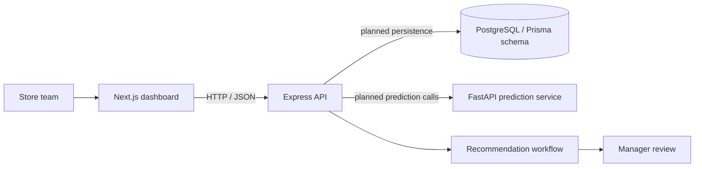

# ZeroWaste AI

### Perishable demand and shelf-life management for grocery retail

ZeroWaste AI is a decision-support project for grocery teams managing products whose demand changes faster than their shelf life. It brings inventory visibility, expiry risk, demand estimates, and proposed actions into one place, with a human review step before recommendations are acted on.

> **Project status: prototype / integration scaffold.** This repository contains a runnable dashboard and API scaffold, typed contracts, a relational data model, and a Python prediction service. Several services still return sample data; the frontend, backend, and ML contracts are not fully aligned yet. Read [Current implementation and limitations](#current-implementation-and-limitations) before treating outputs as operational or model-validated.

## Why this project

Perishable inventory decisions have to balance two risks: ordering too much can lead to spoilage, while ordering too little can lead to stockouts. Expiry dates alone do not capture how quickly an item is likely to sell. ZeroWaste AI is designed to connect inventory batches and sales history with forecast and spoilage estimates, then present possible actions—such as replenishment, markdown, or transfer—for a manager to review.

## What is in the prototype

- **Retail operations dashboard:** summary cards and views for inventory, expiry, forecasts, recommendations, and evaluation.
- **Inventory and expiry contracts:** batch-level inventory types and sample expiry-alert responses.
- **Forecast and spoilage API:** FastAPI endpoints with clearly identified mock calculations, plus a historical-mean forecast baseline in the versioned API.
- **Recommendation workflow skeleton:** sample proposals and in-memory approve/reject state transitions.
- **Relational schema blueprint:** Prisma models for stores, products, inventory batches, sales, forecasts, risk predictions, recommendations, and approvals.
- **Human-in-the-loop direction:** the intended workflow presents recommendations for review before execution; this checkout does not yet implement a complete, persistent approval-and-execution system.

## Architecture



The intended flow is to combine store inventory and sales history, estimate demand and expiry risk, generate candidate actions, and show those actions for human review. The diagram describes the target integration; see the implementation notes below for what is currently connected.

## Technology

| Area | Technologies |
| --- | --- |
| Web app | Next.js 14, React 18, TypeScript, Tailwind CSS, Recharts |
| API | Node.js, Express, TypeScript, Zod, Prisma |
| Prediction service | Python, FastAPI, Pydantic, scikit-learn and XGBoost dependencies |
| Data model | PostgreSQL schema described with Prisma |

## Repository layout

```text
.
├── frontend/                 # Next.js application and typed API client
├── backend/                  # Express API, services, validation, Prisma schema
├── ml-service/               # FastAPI prediction contracts and sample logic
├── docs/
│   ├── architecture.md       # System diagrams and intended data flows
│   └── database-schema.md    # Prisma entities and relationships
├── SETUP_GUIDE.md            # Detailed Windows-first local setup
├── INTEGRATION_MAP.md        # API catalog, module map, integration gaps
└── IMPLEMENTATION_CHECKLIST.md
```

## Get started

### Requirements

- Node.js 20 LTS and npm
- Python 3.13 for the pinned ML-service requirements
- PostgreSQL only if you are setting up Prisma persistence; current sample API services do not require a populated database
- Git

### Install dependencies

From the repository root:

```bash
npm ci
```

Create local environment files from the checked-in examples:

```bash
# macOS / Linux
cp backend/.env.example backend/.env
cp frontend/.env.example frontend/.env.local
```

```powershell
# Windows PowerShell
Copy-Item backend/.env.example backend/.env
Copy-Item frontend/.env.example frontend/.env.local
```

Set `DATABASE_URL` and a private `JWT_SECRET` in `backend/.env` if needed. Keep secrets out of source control and out of `frontend/.env.local`. The frontend's public API setting is `NEXT_PUBLIC_API_BASE_URL`.

### Run the services

Start each service in a separate terminal from the repository root.

**Frontend**

```bash
npm run dev:frontend
```

Open [http://localhost:3000](http://localhost:3000).

**Backend**

```bash
npm run dev:backend
```

The Express health checks are available at [http://localhost:5000/health](http://localhost:5000/health) and [http://localhost:5000/api/health](http://localhost:5000/api/health).

**ML service**

```bash
cd ml-service
python -m venv .venv
```

Activate the virtual environment, then install and run:

```bash
# macOS / Linux
source .venv/bin/activate
```

```powershell
# Windows PowerShell
.\.venv\Scripts\Activate.ps1
```

```bash
python -m pip install -r requirements.txt
python -m uvicorn app.main:app --reload --port 8000
```

Check [http://localhost:8000/health](http://localhost:8000/health) or open the interactive API docs at [http://localhost:8000/docs](http://localhost:8000/docs).

For the complete Windows setup, database configuration, known integration gaps, and troubleshooting, see [SETUP_GUIDE.md](./SETUP_GUIDE.md).

## API overview

The Express app mounts its routes under `/api`:

| Method | Path | Purpose |
| --- | --- | --- |
| `GET` | `/health` | Backend health (also available at `/api/health`) |
| `GET` | `/api/dashboard/summary` | Dashboard summary |
| `GET` | `/api/inventory` | Inventory list |
| `GET` | `/api/inventory/expiry-alerts` | Sample expiry-risk alerts |
| `GET` | `/api/recommendations` | List recommendations |
| `POST` | `/api/recommendations/generate` | Create a sample recommendation |
| `PATCH` | `/api/recommendations/:id/approve` | Update recommendation state |
| `PATCH` | `/api/recommendations/:id/reject` | Reject a recommendation |

The ML service exposes `GET /health`, `POST /api/forecast/demand`, `POST /api/spoilage/risk`, and versioned routes under `/api/v1/ml/`. Request and response schemas are defined in `ml-service/app/`.

## Current implementation and limitations

This section distinguishes implemented prototype behavior from the intended system so that sample values are not mistaken for live retail insights.

- The dashboard summary, inventory list, expiry alerts, and recommendation examples are hard-coded in backend services. Recommendation changes live in process memory and are lost when the server restarts.
- The unversioned ML forecast and spoilage endpoints use deterministic mock formulas. They are not trained or validated predictive models. The versioned forecast endpoint computes a historical-sales mean baseline; it does not return confidence intervals. Versioned spoilage risk is a deterministic sell-through estimate based on a uniform-demand assumption.
- The Prisma schema documents the intended PostgreSQL model, but current backend routes do not persist these sample service responses to the database. There are no checked-in migrations or seed script.
- Frontend requests currently target `/api/v1` and include pages/endpoints not implemented by the current Express route set. As a result, a complete live end-to-end experience is not yet available from a fresh checkout. See [SETUP_GUIDE.md](./SETUP_GUIDE.md) and [INTEGRATION_MAP.md](./INTEGRATION_MAP.md) for specifics.
- The repository contains an architecture and integration plan. Diagrammed components such as a complete agent coordinator, trained forecasting pipeline, role-based authorization, and controlled action execution should be treated as planned work unless implemented in code.

Do not use the sample outputs to make purchasing, food-safety, or disposal decisions. A production deployment needs validated data pipelines and models, persistence, access controls, monitoring, and operational review.

## Development commands

```bash
npm run build:frontend
npm run build:backend
npm run test:backend
npm run lint:frontend
```

ML-service tests can be run from `ml-service/` after installing its requirements:

```bash
python -m pytest
```

These commands are provided as project scripts; check the setup guide for repository-specific caveats before interpreting results as end-to-end validation.

## Project documentation

- [Windows local setup and known limitations](./SETUP_GUIDE.md)
- [Integration map and API catalog](./INTEGRATION_MAP.md)
- [Architecture and data flow](./docs/architecture.md)
- [Database schema and relationships](./docs/database-schema.md)
- [Implementation checklist](./IMPLEMENTATION_CHECKLIST.md)

## Contributing

Contributions that close the documented integration gaps are especially useful. Before opening a pull request:

1. Describe the behavior being added and the relevant limitation or checklist item.
2. Keep API request and response types aligned across the frontend, Express backend, and ML service.
3. Label mock or baseline behavior accurately; do not present it as trained-model performance.
4. Add or update tests and documentation for changed behavior.
5. Never commit credentials, local environment files, or real store/customer data.

## License

No license file is currently included. Until the repository owner adds one, reuse, modification, and redistribution permissions are not specified.
