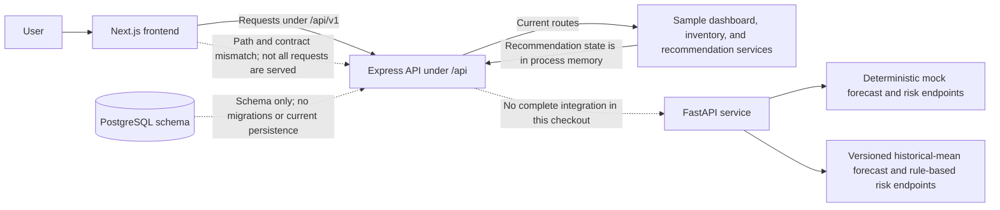
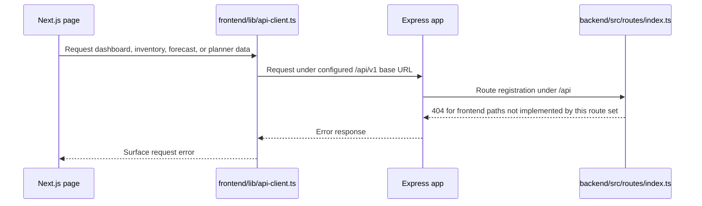
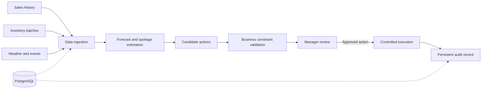

# ZeroWaste AI Architecture and Data Flow

## 1. Current prototype architecture

The diagram below describes the checked-in implementation, not a production deployment.

The frontend API client targets `/api/v1`, while the Express app currently mounts its routes under `/api`. The frontend therefore cannot use all of its current pages and actions against this Express route set. Backend sample services do not persist their responses to PostgreSQL, and recommendation state is lost when the process restarts.

The standalone FastAPI service provides deterministic legacy mock endpoints and versioned endpoints that identify their baseline/rule-based behavior. These are not trained or validated predictive models. The current Express services do not provide a complete integration with this service.

## 2. Implemented request paths

The frontend reports failed requests rather than substituting a successful-looking hard-coded API response.

## 3. Intended data and decision flow

The following is the target architecture. Its database persistence, complete service integration, model validation, and controlled execution are not implemented end to end in this checkout.

Recommendation generation should remain separate from inventory changes. A production workflow must validate actions, require appropriate authorization, prevent invalid inventory quantities, persist decisions, and record execution in an audit trail.

## 4. Database model

`backend/prisma/schema.prisma` describes the intended relational model for users, stores, products, inventory batches, sales, forecasts, spoilage estimates, recommendations, approvals, and audit records. It is a schema blueprint only at present: this checkout has no migration history or seed script, and the current sample services do not use it for persistence. See [database-schema.md](./database-schema.md).

## 5. Service boundaries

- `frontend/`: Next.js user interface and typed API client.
- `backend/`: Express routes and sample domain services, mounted under `/api`.
- `ml-service/`: FastAPI contracts for mock, baseline, and rule-based estimates.
- `backend/prisma/schema.prisma`: intended PostgreSQL data model; not proof of live persistence.

See [INTEGRATION_MAP.md](../INTEGRATION_MAP.md) for the actual route catalog and documented integration gaps.
