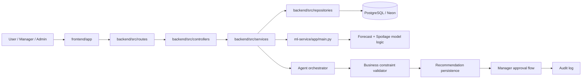
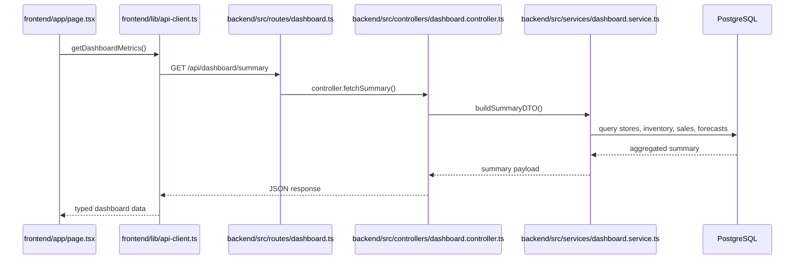
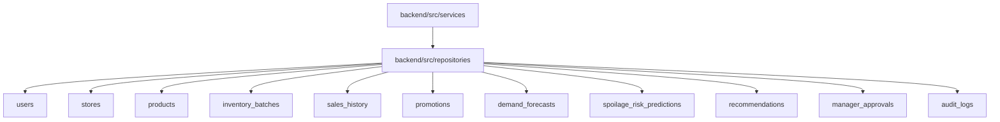
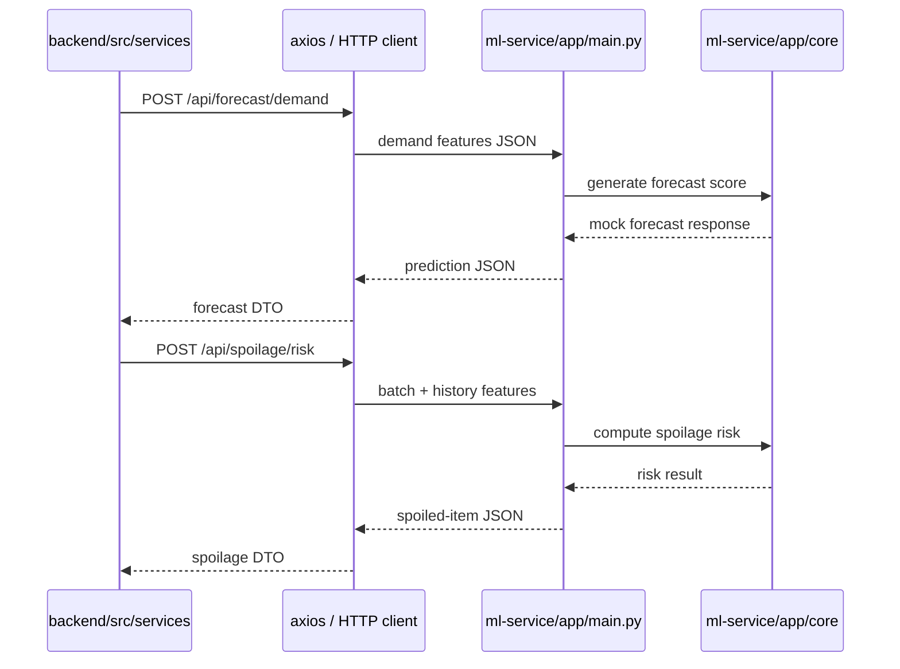
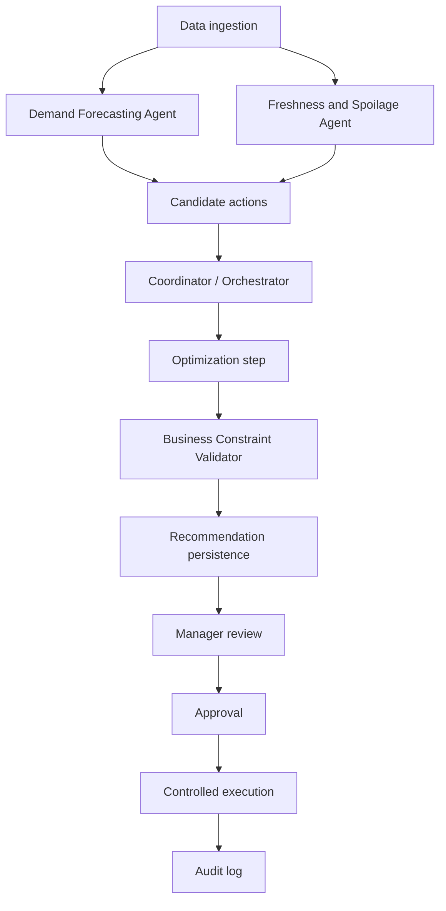
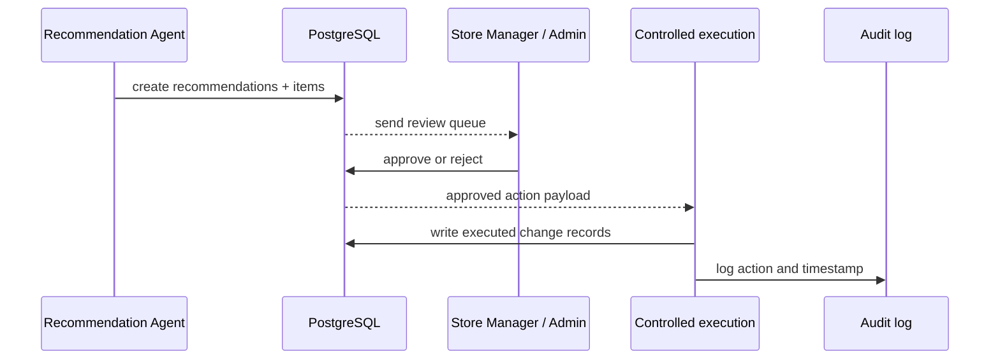
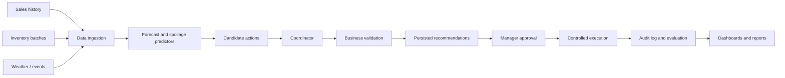

# ZeroWaste AI Architecture and Data Flow

## 1. Overall system architecture

## 2. Frontend-to-backend request flow

## 3. Backend-to-database mapping

## 4. Backend-to-Python ML communication

## 5. Agent orchestration workflow

## 6. Recommendation approval and execution flow

## 7. Complete data lifecycle

## 8. Cross-service module names

These names are used consistently in the code and docs:

- `dashboard.service.ts`
- `inventory.service.ts`
- `forecast.service.ts`
- `spoilage.service.ts`
- `recommendation.service.ts`
- `constraint.service.ts`
- `approval.service.ts`
- `api-client.ts`
- `main.py`
- `schema.prisma`
