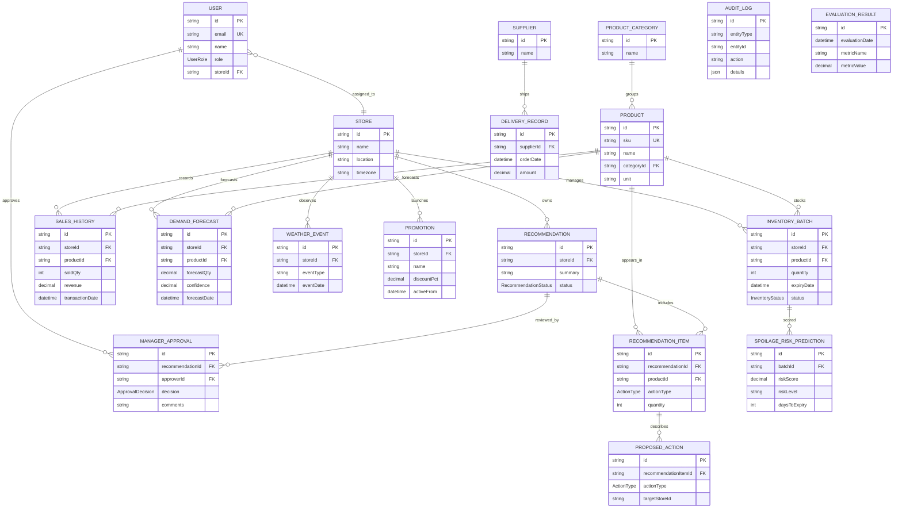

# ZeroWaste AI Prisma ER Diagram and Relationship Table

## Mermaid ER diagram

## Relationship table

| Table | Relationship | Cardinality | Notes |
|---|---|---|---|
| `Store` -> `User` | one store has many users | 1:N | store assignment for admins and managers |
| `Store` -> `InventoryBatch` | one store has many batch records | 1:N | batch-level expiry and quantity |
| `Product` -> `InventoryBatch` | one product has many batches | 1:N | same SKU may exist across stores and batch lifecycles |
| `Product` -> `SalesHistory` | one product has many sales rows | 1:N | supports forecasting and demand analysis |
| `Product` -> `DemandForecast` | one product has many forecast rows | 1:N | forecast by horizon and date |
| `Store` -> `DemandForecast` | one store has many forecast rows | 1:N | per-store forecast planning |
| `InventoryBatch` -> `SpoilageRiskPrediction` | one batch has many spoilage predictions | 1:N | risk score history per batch |
| `Recommendation` -> `RecommendationItem` | one recommendation has many items | 1:N | each item is one action candidate |
| `RecommendationItem` -> `ProposedAction` | one item has many action details | 1:N | action objects for replenish, markdown, transfer |
| `Recommendation` -> `ManagerApproval` | one recommendation has many approval records | 1:N | approval, rejection, or pending state |
| `User` -> `ManagerApproval` | one user can approve many recommendations | 1:N | approver identity |
| `Store` -> `Promotion` | one store has many promotions | 1:N | markdown campaign context |
| `Store` -> `WeatherEvent` | one store has many weather records | 1:N | forecasting features |
| `Supplier` -> `DeliveryRecord` | one supplier has many deliveries | 1:N | inbound replenishment flow |
| `AuditLog` -> `User` | audit log may reference actor | N:1 optional | actions and traceability |

## Important modeling rules

- Inventory expiry is stored at the `InventoryBatch` level instead of on the product master record.
- Demand forecasts are per store and product for a given date horizon.
- Recommendation generation is separate from executed inventory changes to preserve auditability.
- Manager approvals are persisted in a dedicated approval table rather than storing approval directly on recommendation items.
